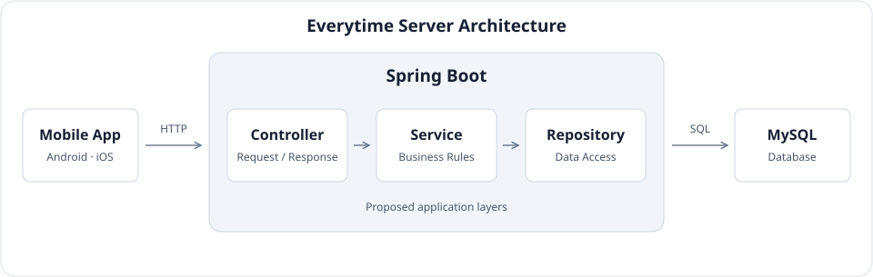

<div align="center">


# Everytime Redesign Server

**39기 SOPT 합동세미나 - 모바일 앱 4조**

강의를 찾아 비교하고 시간표에 담기까지.

[Overview](#-overview) · [Contributors](#-contributors) · [Tech Stack](#-tech-stack) · [Architecture](#-architecture) · [Getting Started](#-getting-started) · [Convention](#-convention)

</div>

<br>

## 📌 Overview

수강신청을 준비하는 학생은 후보 강의를 비교하려고 강의 목록과 강의평을 오가고 강의를 고른 뒤 시간표로 이동합니다. 에브리타임 리디자인 프로젝트는 **강의 탐색 → 강의평 확인 → 시간표 담기** 흐름을
연결합니다. 이 저장소는 모바일 앱에 필요한 API와 데이터를 제공하는 백엔드 프로젝트입니다.

---

## 👥 Contributors

|  |  |  |
|:----------------------------------------------------------------------------------------------:|:-----------------------------------------------------------------------------------------------:|:-------------------------------------------------------------------------------------------:|
|                                          **Backend**                                           |                                           **Backend**                                           |                                         **Backend**                                         |
|                              [홍정우](https://github.com/Erichong7)                               |                              [이승희](https://github.com/sssthnnhee)                               |                              [유채원](https://github.com/ucaeon)                               |

---

## 🛠️ Tech Stack

| 영역 | 기술 |
| --- | --- |
| 언어·빌드 |  **Java 21**<br>Gradle Wrapper |
| 웹 API |  **Spring Boot 4.1.2**<br>Spring MVC와 Bean Validation |
| 데이터 접근 |  **MySQL 8.4**<br>Spring Data JPA |
| 로컬 DB 실행 |  **Docker Compose** |

---

## 🏗️ Architecture

<p align="center">
  
</p>

**현재 연결 구성**<br>
모바일 앱 → Spring Boot → MySQL

**서버 내부 요청 흐름 (설계안)**

```text
모바일 앱 → Controller → Service → Repository → MySQL
```

| 계층 | 역할 |
| --- | --- |
| Controller | HTTP 요청을 받고 입력을 검증한 뒤 응답을 반환합니다. |
| Service | 강의 조회나 시간표 추가에 필요한 업무 규칙을 처리합니다. |
| Repository | Spring Data JPA로 MySQL의 데이터를 조회하고 저장합니다. |

강의 탐색·강의평·시간표별로 코드를 모아 각 팀원이 담당 영역을 쉽게 찾을 수 있도록 구성할 예정입니다.

---

## 🚀 Getting Started

JDK 21과 Docker를 준비하고 프로젝트 루트에서 실행합니다.

1. `.env.example`을 `.env`로 복사합니다.

   ```bash
   cp .env.example .env
   ```

2. `.env`에 아래 값을 설정합니다.

   | 키 | 설정할 값 |
   | --- | --- |
   | `DB_NAME` | 로컬 데이터베이스 이름. 기본값은 `everytime`입니다. |
   | `DB_USERNAME` | Spring이 접속할 로컬 MySQL 계정 이름 |
   | `DB_PASSWORD` | 위 계정의 비밀번호 |
   | `DB_ROOT_PASSWORD` | 로컬 MySQL 관리자 계정의 비밀번호 |
   | `DB_PORT` | Mac에서 접속할 포트. 기본값은 `3306`이며, 사용 중이면 `3307`로 설정합니다. |

3. MySQL을 시작합니다.

   ```bash
   docker compose up -d mysql
   docker compose ps mysql
   ```

4. MySQL 상태가 `healthy`가 되면 서버를 실행합니다.

   ```bash
   ./gradlew bootRun
   ```

   로그에 `Started EverytimeApplication`이 표시되면 서버가 시작된 상태입니다.

---

## 💻 Convention

**이슈 생성 → 브랜치 생성 → PR → 리뷰 → 머지**

[Code Style](#-code-style) · [Commit Tags](#-commit-tags) · [Commit Message](#-commit-message) · [Branch & Merge](#-branch--merge) · [Issue & PR](#-issue--pr) · [API Convention](#-api-convention)

<br>

### 🎨 Code Style

- [네이버 캠퍼스 핵데이 Java 코딩 컨벤션](https://naver.github.io/hackday-conventions-java/)을 따릅니다.
- IntelliJ에 팀 포매터를 적용하고 저장 시 코드 서식과 import를 정리합니다.
- 들여쓰기는 탭 4칸, 줄 길이는 120자를 기준으로 합니다. 한 줄 제어문에도 중괄호를 사용합니다.
- 클래스는 `UpperCamelCase`, 메서드와 변수는 `lowerCamelCase`, 상수는 `UPPER_SNAKE_CASE`로 작성합니다.

<br>

### 🏷️ Commit Tags

|     태그     | 사용 범위                      |
|:----------:|----------------------------|
|   `feat`   | 새 기능 추가                    |
|   `fix`    | 버그 수정                      |
| `refactor` | 동작을 유지하면서 코드 구조 개선         |
|  `style`   | 포맷과 공백 등 코드 형식 수정          |
|   `docs`   | README, Swagger 설명 등 문서 수정 |
|   `test`   | 테스트 코드 추가·수정               |
|  `chore`   | 설정, 의존성 등 기타 작업            |
|    `ci`    | CI/CD 설정 변경                |
|  `rename`  | 파일·폴더 이름 변경 또는 이동          |
|  `remove`  | 파일 삭제                      |
|  `hotfix`  | 배포 환경 긴급 수정                |
|   `init`   | 프로젝트 초기 세팅                 |

<br>

### ✍️ Commit Message

1. `[type/#이슈번호] 제목` 형식을 사용합니다. PR 제목도 같은 형식으로 작성합니다.
2. 타입은 영어 소문자로 씁니다. 제목은 한국어 50자 이내로 작성합니다. 제목은 명사형으로 끝내고 마침표를 생략합니다.
3. 커밋 하나에 논리적 변경 하나를 담습니다. 본문이 필요하면 변경 내용과 이유를 적습니다.

```text
[chore/#3] 프로젝트 README 작성
[feat/#12] 강의 목록 조회 API 구현
[fix/#21] 시간표 중복 추가 오류 수정
```

<br>

### 🌿 Branch & Merge

브랜치 이름은 `type/#이슈번호-작업-요약` 형식입니다. 작업 요약은 영어 소문자와 하이픈으로 최대 세 단어를 사용합니다.

```text
chore/#3-write-readme
feat/#12-lecture-list
```

| 구간                 | 머지 방식                |
|--------------------|----------------------|
| 작업 브랜치 → `develop` | **Squash and merge** |
| `develop` → `main` | **Rebase and merge** |

일반 작업은 `develop`에서 분기합니다. 긴급 수정은 `main`에서 분기하고 `main`과 `develop`에 반영합니다. 두 통합 브랜치의 변경은 PR을 통해 반영합니다.

<br>

### 📋 Issue & PR

| 단계 | 규칙 |
| --- | --- |
| 이슈 생성 | ❗ **필수** · 작업 전에 템플릿을 선택하고 본인을 담당자로 지정합니다. 타입 라벨도 붙입니다. |
| 작업 단위 | 이슈 하나에 브랜치 하나와 PR 하나를 연결합니다. |
| PR 작성 | 관련 이슈와 변경 이유를 적고 확인 결과를 첨부합니다. |
| 리뷰와 머지 | ❗ **필수** · 서브 담당자를 리뷰어로 지정합니다. 최소 1명 승인 후 작성자가 머지하고 작업 브랜치를 삭제합니다. |

| 리뷰 머리말 | 처리 |
| --- | --- |
| ❗ `[필수]` | 수정 후 반영 내용을 공유합니다. |
| `[제안]` | 반영 여부는 작성자가 판단합니다. |
| `[질문]` | 질문에 답변합니다. |
| `[칭찬]` | 좋았던 부분을 공유합니다. |

<br>

### 📡 API Convention

| 항목 | 규칙 |
| --- | --- |
| 공통 응답 | ❗ **필수** · 성공과 실패 모두 `BaseResponse`를 사용합니다. 본문의 `code`는 실제 HTTP 상태 코드와 같은 문자열입니다. |
| 검증 | DTO는 요청 형식을 검증하고 Service는 업무 규칙을 확인합니다. |
| 예외 처리 | 비즈니스 예외는 `BusinessException`으로 던지고 `GlobalExceptionHandler`에서 처리합니다. |
| 페이징 | 요청과 응답 모두 페이지 번호는 **1**부터 시작합니다. |
| API 문서 | 응답 계약을 변경하면 Swagger 설명도 함께 수정합니다. |
